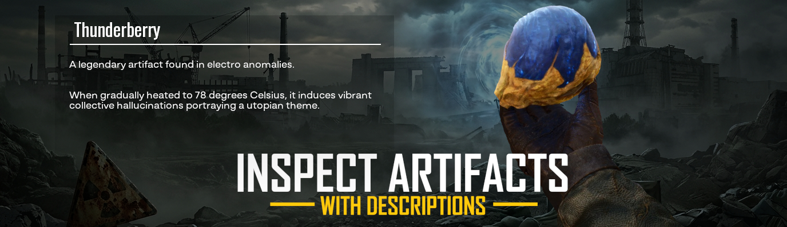
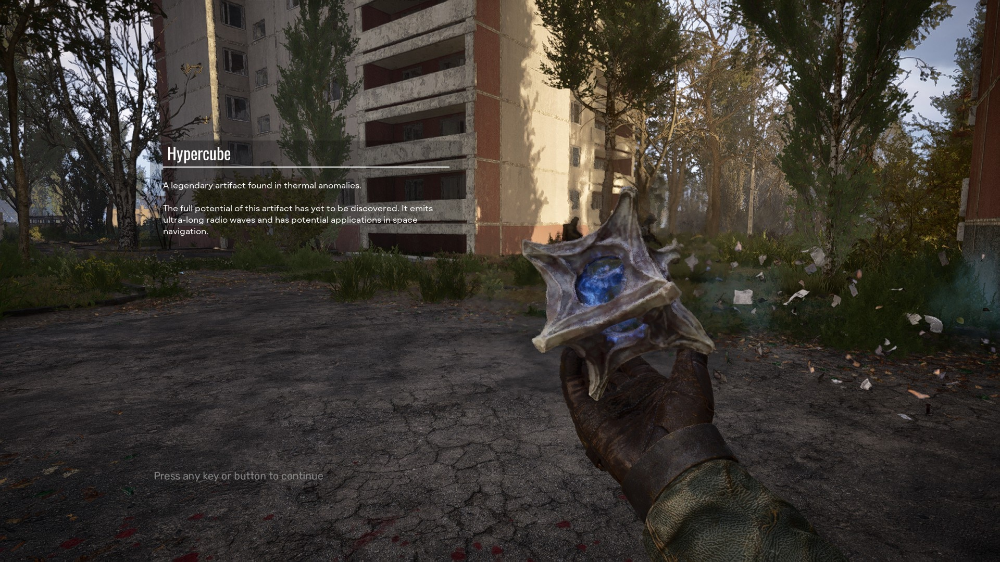
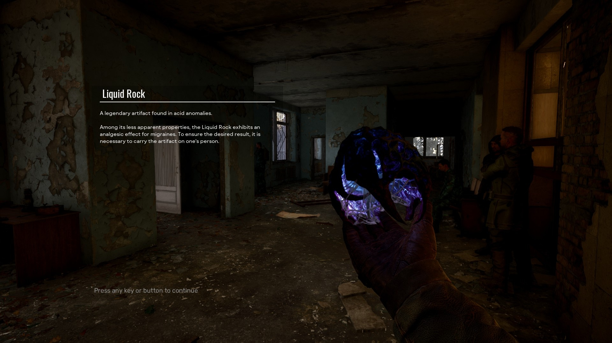
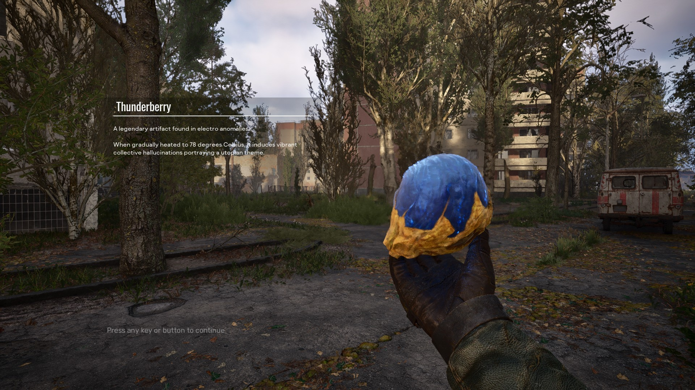

## Available on the Steam Workshop




# Inspect Artifacts with Descriptions

"Inspect Artifacts with Descriptions" is a UI mod for STALKER 2 that adds artifact names and descriptions directly to the artifact inspection screen.

Ever found an interesting artifact and wished you could read about it while holding it in your hand? This mod enhances the inspection view by displaying the artifact's name and description, allowing you to learn more about your discoveries while admiring them.

The mod uses the game's existing localisation files, so it should work with any supported language without requiring separate translations.

## Features

- Displays artifact names during inspection
- Displays artifact descriptions during inspection
- Supports unique artifacts and Cost of Hope DLC artifacts, including Weird Ball, Flickering Flare and Flare Time
- Uses the game's localisation system for multilingual support
- Extends the inspection UI fade-out time to 12 seconds, providing more time to read artifact descriptions
- Lightweight asset-only modification

## Screenshots

### Hypercube



### Liquid Rock



### Thunderberry



## Installation

You can install the mod from the [steam workshop](https://steamcommunity.com/sharedfiles/filedetails/?id=3811216482&tscn=1792971660)  

## Repository Contents

This repository contains the Unreal Engine assets used by the mod, along with a few tools for keeping the artifact details up to date.

To work on the mod, put the repository in your Zone Kit installation's `Stalker2\Mods\ArtifactUI` folder, then open the project in Zone Kit.

### How the new version works

The old version guessed the right name and description from the artifact's Blueprint name. That worked for most ordinary artifacts, but unique and DLC artifacts don't always follow the same naming pattern.

The new version uses a lookup list generated from the game's item data instead. It matches the artifact's class to the correct localisation ID, then uses that ID to get the name and description from the game.

The list lives in [ArtifactLocalization.json](Data/ArtifactLocalization.json). It only contains identifiers, not the actual descriptions or translations. Before packaging, we copy that list into a map inside the widget, so the game doesn't need to read the JSON itself.

Hypercube, Weird Ball, Flickering Flare and Flare Time have all been tested in-game with the new lookup.

### Updating the list when new artifacts are added

If a game update adds more artifacts, the list will need refreshing. There's no need to enter them all by hand:

1. Extract the latest English `Game.locres` and the base game/DLC `ItemPrototypes.cfg.bin` files using Zone Kit's UnrealPak. Use files from the updated game, not an old extraction.
2. With Python 3.10 or later, run the following from the mod's folder, replacing the example paths with your extracted files:

   ```powershell
   python Tools\generate_localization_map.py --locres "C:\Extracted\Game.locres" --prototypes "C:\Extracted\Base\ItemPrototypes.cfg.bin" "C:\Extracted\DLC\ItemPrototypes.cfg.bin" --output Data\ArtifactLocalization.json
   ```

   Include the prototype files for any new DLC too. The generator creates the JSON and reports missing text or conflicting mappings.

3. Open the project in Zone Kit and run [import_widget_map.py](Tools/import_widget_map.py) in its Python console. For example, with Zone Kit installed at `X:\STALKER2ZoneKit`:

   ```python
   exec(open(r"X:\STALKER2ZoneKit\Stalker2\Mods\ArtifactUI\Tools\import_widget_map.py").read())
   ```

   This copies the JSON into the widget's map, compiles the Blueprint and saves it.

4. Run [verify_widget.py](Tools/verify_widget.py) in the same console:

   ```python
   exec(open(r"X:\STALKER2ZoneKit\Stalker2\Mods\ArtifactUI\Tools\verify_widget.py").read())
   ```

   Check **Compiler Results** for errors as well. The verification script checks the map, but can't read the compiler status in this Zone Kit build.

5. Cook and package the mod again, then test an ordinary artifact, a unique artifact and the new additions in-game. Don't skip cooking after changing the widget, or you could package the old version.

You can also run the mapping tests from the mod's folder:

```powershell
python -B -m unittest discover -s Tests -v
```

This workflow assumes the game's data format and localisation system haven't changed. Future DLC or third-party artifacts aren't picked up automatically just by installing them.

## Compatibility

- STALKER 2: Heart of Chornobyl
- Uses the game's existing translations for supported artifacts
- Includes mappings for installed base game and Cost of Hope DLC artifacts

  
## Known Issues

- The previous artifact's text can briefly appear when reopening inspection, before the correct details update. 

## Contributing

Issues, suggestions, and improvements are welcome. Feel free to open an issue or submit a pull request.

## Acknowledgements

Special thanks to the STALKER 2 Modding Discord community and Zivaka for their assistance, research, and support during development.

## Disclaimer

STALKER, STALKER 2, and all related assets and trademarks belong to GSC Game World. This project is a fan-made modification and is not affiliated with or endorsed by GSC Game World.
