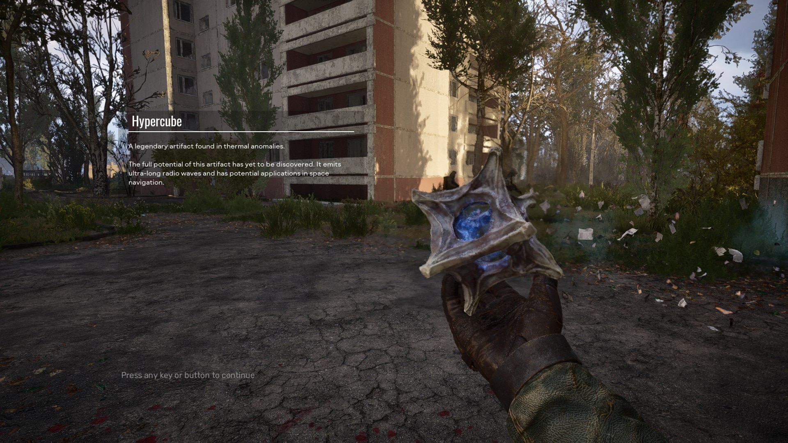
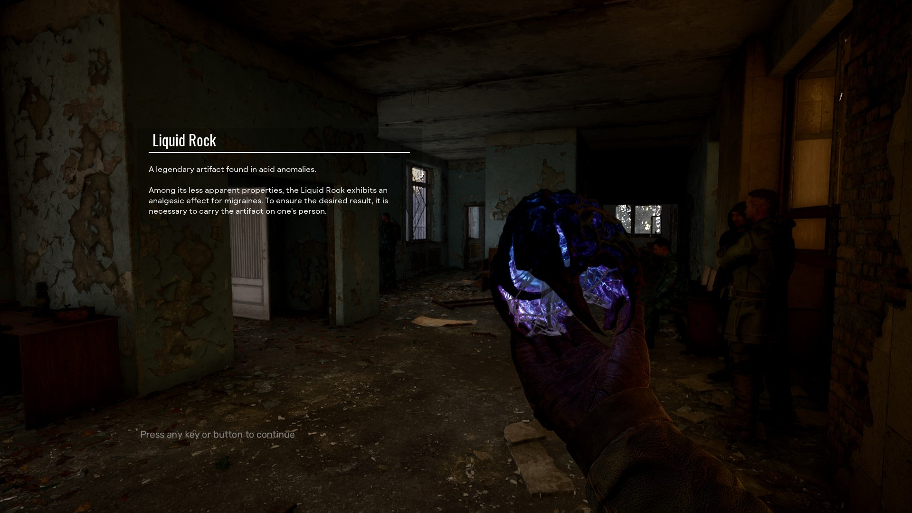
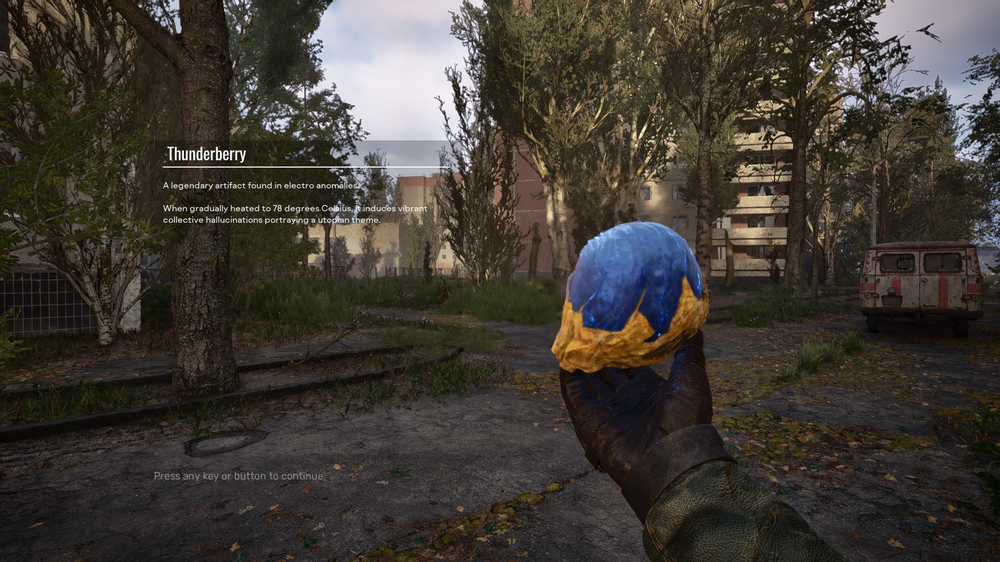

# ArtifactUI

ArtifactUI is a UI mod for STALKER 2 that adds artifact names and descriptions directly to the artifact inspection screen.

Ever found an interesting artifact and wished you could read about it while holding it in your hand? This mod enhances the inspection view by displaying the artifact's name and description, allowing you to learn more about your discoveries while admiring them.

The mod uses the game's existing localisation files, so it should work with any supported language without requiring separate translations.

## Features

- Displays artifact names during inspection
- Displays artifact descriptions during inspection
- Uses the game's localisation system for multilingual support
- Extends the inspection UI fade-out time to 12 seconds, providing more time to read artifact descriptions
- Lightweight asset-only modification

## Screenshots

### Hypercube

### Liquid Rock

### Thunderberry

## Installation

You can install the mod from the [steam workshop](https://steamcommunity.com/sharedfiles/filedetails/?id=3811216482&tscn=1792971660)  

## Repository Contents

This repository contains the Unreal Engine asset (`.uasset`) files used by the mod.
Download the repository to your your Zonekit/Stalker2/Mods folder to make changes and package the mod.

## Compatibility

- STALKER 2: Heart of Chornobyl
- Compatible with all game languages supported by the base game localisation files

  
## Known Issues

Unique artifacts (like the watch from the cost of hope DLC) don't work - they display either blank text, or the previously inspected artifact's text.

## Contributing

Issues, suggestions, and improvements are welcome. Feel free to open an issue or submit a pull request.

## Acknowledgements

Special thanks to the STALKER 2 Modding Discord community and Zivaka for their assistance, research, and support during development.

## Disclaimer

STALKER, STALKER 2, and all related assets and trademarks belong to GSC Game World. This project is a fan-made modification and is not affiliated with or endorsed by GSC Game World.
